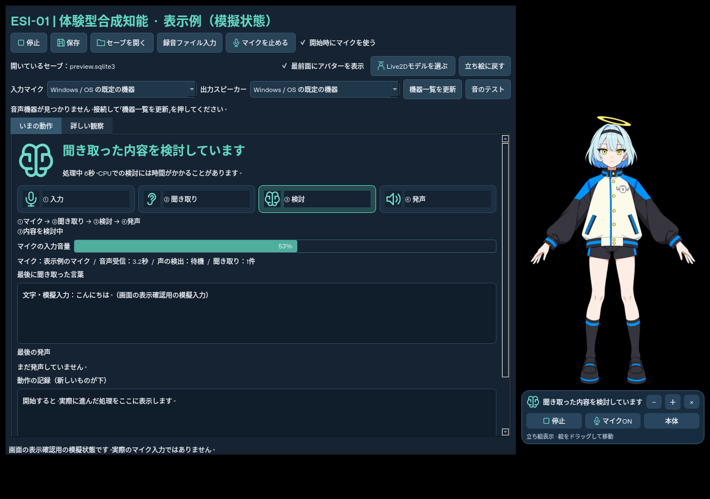
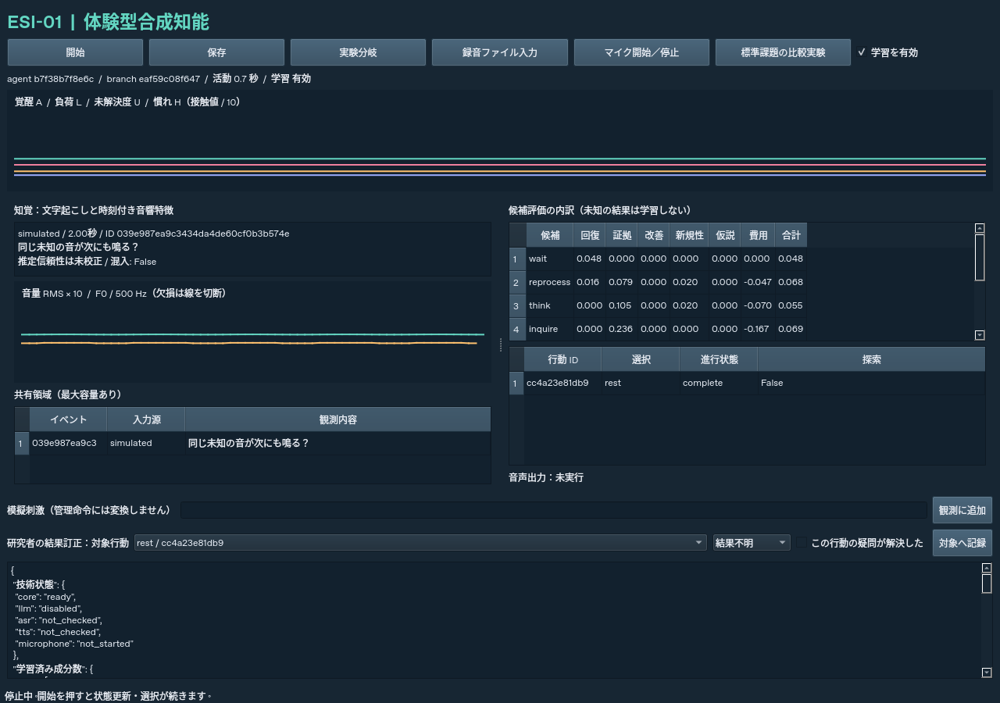

# ESI-01 — 体験型合成知能

ESI（Experiential Synthetic Intelligence）の最初の研究用プロトタイプです。会話ごとに必ず返事するチャットではなく、観測、内部状態、経験記憶、結果予測から待機・再処理・検討・確認・発声・休止を選びます。人格や感情的な自己紹介は初期設定していません。

M0〜M3 に対応する初期実装です。マイク・録音・模擬刺激、時刻付き音響特徴、常駐状態、共有領域、ローカル LLM/TTS、オンライン予測学習、保存・再開、実験分岐、処理再生、留保課題と学習停止条件の比較、観察 GUI を備えています。Windows の物理機器・CUDA は実機確認が残っています。

音声出力は **AivisSpeech / [凛音エル](https://hub.aivis-project.com/aivm-models/f5017410-fbb5-49e1-97cb-e785f42e15f5)** v1.0.0、初期スタイル「ノーマル」です。モデル UUID・話者 UUID・版・スタイル名を照合して選択し、未導入や不一致の場合は明示的に失敗します。音声モデルのキャラクター説明を ESI の人格として与えることはありません。

**0.2.0（システム名はESI-01）** では、ダブルクリック起動、セーブを開くボタン、アイコン付きの進行表示、最前面のアバターと開始・停止／マイク操作を追加しました。立ち絵をドラッグして位置、＋／−で大きさを変更できます。本体を最小化してもアバターは残ります。同梱の凛音エルは背景透過の立ち絵です。**凛音エルの完成したLive2Dモデルは未制作・未同梱**です。書き出し済みのCubismモデルを読み込む表示機能は公式サンプルで検証しました。[更新と使い方](docs/アバターと簡単起動.md)を参照してください。

マイク・スピーカー選択、出力のテスト音、聞き取り前からの入力音量、処理段階と経過秒数、動作記録も利用できます。「開始時にマイクを使う」は初期値で有効です。最初の画面は「いまの動作」、研究用の数値は「詳しい観察」です。[音声の画面の見方](docs/画面と音声の確認.md)も参照してください。



## このクラウドで起動する

```bash
cd /workspace/Experiential-Synthetic-Intelligence-ESI-Project
source /workspace/esi-environment/activate.sh
python /workspace/esi-environment/start_services.py
esi --config config/cloud.toml doctor
esi --config config/cloud.toml gui
```

このクラウドは画面がないため、GUI の内部検証には `QT_QPA_PLATFORM=offscreen` を指定します。GUI の画像検証はできますが、ユーザーのマイクや画面へは接続しません。音声出力は WAV ファイルとして保存します。

```bash
# 音声機器・モデルなしで状態と選択を検証（別の実験DB）
esi --database data/simulation.sqlite3 simulate --text '次にも同じ音が鳴る？'

# モデルを使って録音を観測。秒数は検証時の実行時間であり、遅延目標ではない
esi --config config/cloud.toml --database data/audio.sqlite3 run --audio input.wav --seconds 120

# 学習あり／停止の比較。既存出力は上書きしない
esi compare --output data/study-01 --trials 80

# 保存状態のコピーだけで評価
esi --database data/audio.sqlite3 evaluate --output data/evaluation-01

# 実験分岐と、当時のLLM出力を使う厳密な処理再生
esi --database data/audio.sqlite3 branch --output data/frozen.sqlite3 --freeze
esi --database data/audio.sqlite3 branch --output data/no-acoustics.sqlite3 --no-acoustics
esi --database data/audio.sqlite3 branch --output data/no-workspace.sqlite3 --no-workspace
esi --database data/audio.sqlite3 replay --output data/replayed.sqlite3
```

設定は DB と一緒に保存します。再開は同じ `--database` を指定してください。設定を変更するときは別の分岐を作ります。停止中の時間は経験時間や状態減衰に含めません。保存された `agent_id` は再開・分岐でも維持し、分岐では別の `branch_id` を割り当てます。
同じ実験 DB に書き込む常駐プロセスは1つにしてください。`status` は読み取り専用です。



## 実機で起動する

[初めての導入手順](docs/はじめての導入.md)には、Windows でダウンロードするもの・フォルダーの開き方・コマンドを入れる順番を記載しています。

[Windows 手順](docs/windows.md)に Python、モデル、AivisSpeech・凛音エル、CUDA 対応 llama.cpp、マイク確認の手順を記載しています。

## モジュールと記録

- `core.py`: 数値状態・固定評価規則・候補選択・共有領域。音声文字列から管理操作は実行しません。
- `learning.py`: 行動別・成分別の正則化 RLS。選んだ行動の観測済み成分だけを更新します。未知は `None` で、ゼロ報酬に変換しません。
- `audio.py`: 有界の取得/VAD/ASR キュー、Silero ONNX、faster-whisper CPU int8、32ms の RMS/F0 系列。F0 欠損、未校正の ASR 指標、TTS 混入を区別します。
- `adapters.py` / `runtime.py`: 1つの LLM 推論スロットと非同期 ASR/TTS。古い結果や失敗を記録し、数値状態の更新を継続します。
- `storage.py`: SQLite WAL と整合したスナップショット。初期/保持境界からの入力コマンドとモデル結果で再生できます。
- `gui.py`: 音響・状態・共有項目・評価寄与・進行中の行動・結果/学習・技術状態の観察と、研究者専用操作。
- `devices.py` / `presentation.py`: 実験設定と独立した機器選択の保存、実際の処理状態を日本語で表示。16kHz mono に対応しない機器は検証したネイティブ形式で取得・再生し、音声認識用の16kHz monoに変換します。
- `desktop.py`: 起動状況を表示しながらローカルサービスを準備。既存エンジンを再利用し、自分で起動したllamaだけを終了します。二重起動を防ぎます。
- `avatar.py`: 本体と独立した透過・最前面ウィンドウ。立ち絵と実際のCubism MOC3を区別し、モデルを選択できます。`model_probe.py`でネイティブモデルの読込みを別プロセスで事前確認します。
- `experiments.py`: 訓練と留保を分けた任意記号の測定課題。モデル自己採点を教師に使いません。

意味カテゴリは LLM の推定として独立して保存し、結果予測の特徴に使います。LLM の出力は JSON と参照 ID を検証します。言語入力は観測4件、記憶4件、短い要約までに制限し、詳細音響系列は DB に残します。参照 ID の短縮対応と実際の入出力は `llm_io` に記録します。生成発声は `self_output` であり、外部証拠や正解として自動学習しません。

研究者の訂正は `action_id` を指定します。既知の成分を訂正した場合は保持中の教師履歴から再構築し、二重に数えません。保持されていない古い行動への訂正は拒否します。改善成分の教師は `verified_holdout` の測定だけが受理されます。GUI の結果訂正は証拠取得の指定であり、「ご機嫌」を直接操作するものではありません。

## 初期の制限と調整可能な仮定

評価係数、時間定数、探索確率、発声間隔、CPU スレッド、処理期限は `Settings` と TOML で公開しています。初期予測の切片は設計上の仮定です。学習するのは結果予測であり、LLM 重みや評価規則自体をオンライン訓練しません。F0 は単純な自己相関の推定で、複雑な声・雑音での精度は実機で調べてください。

無音時も状態更新・注意・軽い経験検索を行います。初版の発声候補は参照できる外部観測があるときに作り、証拠なしの同じ問いの自動発声ループは作りません。LLM の無音時の毎周期呼出しもありません。キュー超過・モデル停止・再生故障は沈黙と分けて表示します。反響キャンセルは未実装で、マイクは TTS 中も継続します。

録音入力は初期値で最大120秒、連続発話は最大12秒、保存音声は入力/出力それぞれ1GBです。容量到達は明示的な失敗にします。長い録音は分割してください。処理記録は20万件に達すると整合した保存境界より古い記録を整理し、その境界からの再生に切り替えます。元の全期間を再生したい場合は、研究者が事前に DB・音声を別途アーカイブしてください。スナップショットは保持境界と直近64件を残します。

モデル未導入・故障を代替人格や架空の成功で補いません。録音処理では全観測を保存し、混雑時の重い検討は新しい観測を優先して旧要求を記録付きで取り消します。終了時は適用待ち結果を取り消して保存します。処理中の HTTP 要求自体はタイムアウトまで残る場合があります。

M4 の長期自己評価・再処理による傾向学習、映像・YouTube・LLM 本体の学習は今後の範囲です。IQ120、意識、主観的な感情の成立は、このプログラムや模擬課題の成績から主張しません。事前学習済みモデルに由来する言語能力と、この実装が学習した予測は別物です。

## 開発と検証

```bash
python -m pip install --require-hashes -r requirements.lock
python -m pip install --require-hashes --no-deps -r requirements-live2d.lock
python -m pip install --no-deps -e .
pytest -q -m 'not integration'
ESI_RUN_INTEGRATION=1 pytest -q  # 実際のローカルモデル・エンジンが必要
ruff check src tests scripts
```

依存関係は `pyproject.toml`、版・ハッシュは `requirements.lock` と `requirements-live2d.lock` に固定しています。通常の開発では既存チェックアウトを使用し、新しい worktree は必要ありません。[設計書](docs/ESI-01-design.md)と[検証記録](docs/validation.md)も参照してください。
