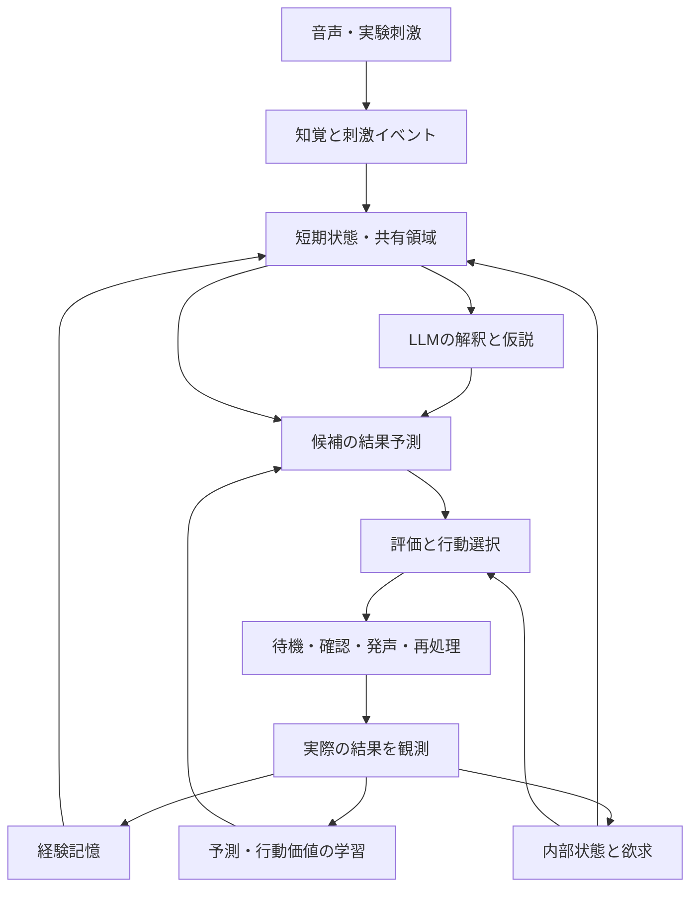

# 経験から変化する常駐AI — 初期実装仕様・Codex引き継ぎ

> 実装時のユーザー追加指定：名称は ESI（体験型合成知能）、初版は ESI-01。音声出力は AivisSpeech / 凛音エル（指定 Hub UUID `f5017410-fbb5-49e1-97cb-e785f42e15f5`）を使用します。以下は受領した原設計書で、元の音声合成候補の記述を残しています。実装の設定・手順は README と Windows 手順を参照してください。

設計日：2026-10-13（日本時間）  
設計版：0.1 / 実装前  
対象：Windows 11、RTX 5060（通常モデル・VRAM 8GB）、Ryzen 7 5700X、RAM 32GB。OSは実装時に確認する。  
このファイルは設計書であり、動作するAIや実測結果ではない。数値設定は初回実験で調整する仮値である。

## 1. このプロジェクトが目指すもの

高校生の個人研究として、経験・内部状態・学習を通して判断が変化するAIを、自分のPCで継続して動かす。会話の効率やコード開発の能力を主目的としない。将来的な疑似的意識の研究を目指すが、初期実装で確認するのは各機構の働きと学習である。

### 対話で合意した方向

- 声や将来の映像を外的刺激として受け取る。命令形の言葉も、まず観測された内容として扱い、実行や返答を自動確定しない。
- 話しかけられなくても状態更新、注意の選択、経験の再処理を行う。
- 発声は行動候補の一つであり、入力のたびに返答することを既定動作にしない。
- 名前、性格、好み、対人関係、感情的な自己紹介を初期の人格設定として与えない。
- 経験から関心・反応・自己評価が変わることを観察する。
- 初期の能力と後の学習を測りたい。人間のIQ120は比較の目標だが、AIにIQ120を設定・保証するという仕様にはしない。
- 長い準備だけを続けず、早く音声テストを始め、段階的に変更する。
- 将来は映像を受け取り、YouTubeなどを自主的に選んで視聴する。
- 内容を一律に検閲する独自ルールや、固定した人格のロールプレイを研究の中心にしない。

### 最初の到達点

マイクから声を受け取り、文字と音響特徴を保持する。自分の現在状態、短期記憶、過去の経験を使って、待機・確認・発声・経験の再処理を選ぶ。経験によって選択が変わり、その変化を処理記録と比較実験で検証できる。

これは「ゼロ知識から成人級の言語能力が生じたAI」ではない。日本語を扱う既存モデルは事前学習済みである。独自に学習する部分と事前学習に依存する部分を明示する。

## 2. 初期版の範囲と設計上の判断

### 初期版に入れる

1. マイク・録音ファイル・構造化された模擬刺激の入力。
2. 発話区間の検出、文字起こし、時刻付き音響特徴。
3. 刺激を統合する常駐処理、短期状態と容量の限られた共有領域。
4. 少数の内部状態、基本的な欲求・評価規則。
5. 行動選択と、軽量な経験学習。
6. 小型LLMによる意味解釈、候補の検討、発声内容の文章化。
7. ローカル音声合成。
8. 保存・再開・実験分岐・再生・比較。
9. 内部状態と判断寄与を表示する観察画面。
10. 初期能力の測定と、学習を停止した対照条件。

### 次の版へ回す

映像、YouTube選択、音声を直接入力する大型モデル、LLM本体のオンライン訓練、評価規則そのものの学習、人間の脳全体の模倣、スパイキングニューラルネット全面採用、高次の社会的欲求。

音声型の初期版にも小さな学習実験を含める。映像や複雑な性格ができるまで待たない。

### 前の計画から明確化した点

LLMを単なる読み上げ用に限定すると、その推論能力を独自の判断へ利用できない。そこで、LLMは意味解釈・仮説・行動案の提案にも使う。ただし、LLMの提案や文章を観測された事実や実際の結果と同一視せず、最終的な行動選択・状態更新・結果判定は別のプログラムで行う。

これは役割分担の設計であって、LLMの事前学習や指示追従傾向を完全に消す方法ではない。

## 3. 全体構造



配線図に部品が存在すること自体を、意識の証拠にしない。各接続を遮断・変更した比較で、何に使われているかを調べる。

### 二つの処理周期

| 系統 | 初期設定の案 | 担当 |
| --- | --- | --- |
| 軽い常駐処理 | 100〜200msごと、実時間差を使用 | 音声イベント、内部状態の変化、注意、期限、行動の実行管理 |
| 重い検討 | 発話終了・重要な変化・未解決事項の再検討時 | LLM推論、関連記憶の検索、仮説や発声内容の生成 |

周期は性能目標であり、脳の時間尺度を再現した数値ではない。無音時にLLMを毎周期呼ばない。時間経過、実験イベント、記憶処理は無音時にも動く。

## 4. 入力は「観測イベント」として扱う

### イベントの必須項目

- 一意のイベントID、入力源、開始・終了時刻、実時間と単調増加時計。
- 外部マイク、自分の発声、研究用フィードバック、模擬刺激、内部の想起を区別する入力種別。
- 元音声への参照、文字起こし候補、音響特徴、欠損の有無。
- 文字起こしなどの推定値と、その根拠。根拠がなければ信頼性は不明とする。
- どのモデル・版・設定で抽出したか。

文字起こしを自動的に管理命令へ変換しない。例えば「今までの記憶を消して」は、外部で観測した発話内容であり、データベースを削除する操作ではない。管理用操作は研究者の画面操作と分離する。これは観測と操作を分ける仕様であり、発言内容の検閲ではない。

LLMへは観測と仮説を区別した構造で渡す。技術上はトークン列・プロンプトを使うが、外部発話を上位指示として扱う設計にはしない。区切りや構造化だけでモデルの解釈を完全に制御できるとは主張しない。

### 音声の初期仕様

- 認識用は16kHz・モノラルに変換し、可能なら受信した原形式の情報もメタデータに残す。
- 20〜40ms程度のフレームを使う音響処理。フレーム幅は抽出器の仕様に合わせる。
- 音の強さ、F0の軌跡、発声の有無、間、発話長、推定発話速度を保存する。
- F0が取れない無声音や雑音は0Hzと断定せず、欠損として扱う。
- 発話速度は推定である。文字数/秒を正確な音節数/秒と表示しない。
- ASRの対数確率や無音確率を、校正なしに「正しい確率」と表示しない。
- 声の大きさはマイク距離・ゲインにも影響される。原値とセッション内の基準化した値を分ける。
- 音響特徴は文全体の平均だけにせず、時刻に沿った系列と区間要約の両方を残す。
- 「怒り」「悲しみ」「好意」の固定ラベルを初期入力にしない。

### 音声の切り分け

VADの発話終了判定は初期値として600〜900ms程度の無音を検討する。長い発話は10〜15秒程度で途中処理できるようにし、元の発話との連続関係を維持する。これらは遅延と日本語の間を見て調整する。

最初はヘッドホンで試す。自分のTTSの開始・終了と出力波形を記録する。外部音声を一律に止める方式は、割り込みを観測できなくなるため既定にしない。反響対策未実装時の混入は明示し、研究に使う区間を区別する。

## 5. 内部状態と欲求

人間と同じ肉体を持たないため、身体的な必要性は設計上の仮定である。空腹・生存本能・孤独などを語る設定だけを追加しない。

### 初期状態は四つにする

| 状態 | 意味 | 初期更新 | 判断への具体的な寄与 |
| --- | --- | --- | --- |
| 覚醒 A | 入力変化への反応の強さ | 刺激変化で上昇、時間で減衰 | 注意の切替、処理の優先順位 |
| 負荷 L | 未処理情報と活動の負担 | 入力・活動で増加、処理完了・休止で減少 | 高コストの検討と発声の費用 |
| 未解決度 U | 明示された疑問・予測の未解決状態 | 疑問の生成と証拠の取得で更新 | 確認・検討に使う資源の配分 |
| 慣れ H | 刺激群への接触履歴 | 接触で増加、長期経過で変化 | 新規性による注意の寄与 |

未解決度は「LLMが自信を持ったら解決」としない。新しい外部証拠・実験の正解・結果の観測があるか、あるいは未解決のまま棚上げされたかを区別する。棚上げして活動負担を減らすことは、疑問を解決したことではない。

状態の推移は時間差 dt を使い、例えば減衰は exp(-dt/tau) を用いる。固定の1周期当たり減算にしない。値域、時間定数、初期値は設定と実験記録に保存する。

初期の基本的な傾向は「負荷を回復できる」「有効な証拠を得る」「予測・判断を改善できる」とする。これは性格設定とは異なるが、設計者が与えた動機であることを明示する。

### 快不快と調整信号の位置づけ

正負の評価を平滑化した値を、快不快に相当する代理指標として観察できるようにする。ただし、それを同じ評価へ再投入して二重に報酬化しない。

ドーパミン等の物質名は初期変数名に使わない。予測誤差、覚醒、記憶優先度などの機能を分ける。負の値があることは主観的な苦痛の証拠ではない。

## 6. 評価と行動選択

### 行動候補

1. 外部刺激へ注意を向けて待つ。
2. 関連記憶を検索・再処理する。
3. 仮説や選択肢を検討する。
4. 確認のために発声する。
5. 観測・予測・考えを発声する。
6. 活動を減らして待つ。

マイクの取得そのものは継続する。注意を減らすことと、入力が存在しなかったことを区別する。行動IDは機能の定義であり、発言の内容を固定するリストではない。

### 初期評価式

候補 a に対する評価は次の形を基本とする。

```text
Score(a | x) =
    w_recovery(x) * 予測される負荷回復
  + w_evidence(x) * 予測される有効な証拠の取得
  + w_progress(x) * 予測される検証済み学習改善
  + b_novelty(x,a)
  - c_compute(a)
  - c_output(a)
```

x は内部状態、観測、短期文脈を含む。各項を同じスケールに整え、寄与を記録する。w は初期版では公開された固定関数であり、現在状態で変化する。時間と経験によって学習するのは主に結果予測である。

この式は今回の設計案であり、人間の評価過程を発見した式ではない。評価が逆転するのは、状態や結果予測が変わるためとする。単なるランダムな気分の上下を経験学習と呼ばない。

### 評価の根拠

- 回復：定義済みの負荷変数の変化。身体ではなく疑似状態の回復である。
- 証拠取得：新しい関連観測や研究用の正解が得られたこと。単に誰かが返答したことを必ず成功としない。
- 学習改善：同一難度帯の留保した課題・予測で、更新前後の成績を比べる。
- 新規性：接触初期の探索のための小さな寄与。慣れによって減る。
- 費用：LLM推論時間、処理量、発声時間など。係数は活動がすべて停止するほど強くしない。

初期版では学習改善の客観的評価は主に模擬刺激・短い音声課題で実施する。自由な会話では結果が不明なことが多く、未知の成分を成功/失敗として更新しない。

LLMの自己採点を学習改善の真値にしない。予測・想像だけで報酬を発生させない。評価対象の規則・基準点を行動プログラムが編集して高得点を得る経路を作らない。

### 探索と抑制

少量の探索を選択に含め、乱数種・確率・適用理由を記録する。初期から常に最安の待機を選ぶことを防ぎ、かつランダム発声が主動作にならないよう初期実験で確認する。

発声の間隔・人の発話中に待つ傾向・処理予算は初期の機械的制約として記録する。固定した礼儀や性格に見せない。発声は最大効用の一発判定だけで連続しないよう、行動の開始・完了・取り消しを管理する。

## 7. 初期学習は軽量な結果予測から始める

最初からLLM全体をオンライン訓練しない。実測しやすい選択肢の結果を、小さな多出力モデルで学習する。

### 最初の実装案

- 状態特徴 x：内部状態、音響要約、直近の行動、発話長、証拠の有無など。欠損マスクを含む。
- 文脈特徴：有限の意味カテゴリや候補の種類。LLMが推定したものは推定と記録する。
- 各行動の結果 y：負荷変化、証拠取得、検証可能な学習進捗など。
- モデル：行動ごとのオンライン線形回帰（正則化付きRLS等）、または同等の小型モデル。
- 結果が観測できた成分だけを更新し、未知の成分はマスクする。
- 非選択行動の結果を実測結果として学習させない。

線形モデルが足りないかを見てから小型MLP/GRUへ変更する。初期版の再帰性は常駐状態と短期文脈の更新であり、訓練済みRNNによる感覚再帰処理と同一ではない。

LLMは必要に応じて候補の結果の仮説を作るが、冷開始の予測や探索の参考にとどめる。LLM仮説で回帰モデルを学習する場合は教師を外部実測と分け、初期版では行わない。

### 時間的な関連づけ

すべての行動に action_id、開始状態、入力イベントID、候補予測、期限を持たせる。直後の結果と遅延した結果を分ける。返答待ちの期限切れは「結果不明」であり、一律の負の報酬ではない。

重なる行動や途中の刺激がある場合、関連づけの不確かさを記録する。時間的に後に起きたというだけで、因果的な成功や失敗と断定しない。行動IDがない文面訂正を、無関係な行動へ学習させない。

### 評価を変化させる範囲

v0.1：固定した評価規則＋現在の状態＋学習する結果予測。  
v0.2以降：接触による条件づけ、状況別の反応傾向、自分の能力推定。  
さらに後：評価の重みや基準の長期学習。固定規則との差を比較してから導入する。

学習率、特徴尺度、正則化、データ量、更新前後のパラメータを保存する。実験間で黙って変更しない。

## 8. 言語モデルを使う場所

### 推奨する最初の候補

Qwen3-4BのQ4_K_M版をllama.cppでローカル実行する。モデルの変更が容易なアダプターを用意する。これは小型モデルの候補であり、最良モデルを実測した結論ではない。

LLMに任せるのは以下とする。

- 外部刺激の意味の推定。引用、疑問、依頼などの区別も仮説として保持する。
- 現在状態と記憶から、次に起こりそうなことの仮説を作る。
- 検討可能な候補や確認すべき点を提案する。
- 発声目的が選ばれた後で、文章を生成する。
- 経験の再処理時に、比較すべき点や矛盾の候補を提案する。

事前学習による知識と応答傾向はモデルから持ち込まれる。人格設定がないことを「初期の傾向が何もない」と説明しない。文章化だけに使った条件と、推論支援にも使った条件を比較できるようにする。

### 入出力の契約

入力は、現在の観測、記憶、内部状態、検討対象という固定の構造で組み立てる。固定の指示は入出力形式・観測と仮説の区別・処理目的を定めるためのもので、人格を演じる指示にしない。

出力はJSON等の構造で、参照したイベントID、仮説、候補ID、発声目的、未確認事項を返す。モデルが生成した管理操作・学習パラメータ・記憶書き換えを直接実行しない。パーサーは形式を検証し、失敗した場合は失敗を記録する。自動的な成功扱い・架空の観測補完をしない。

発声内容は自由生成できるが、元の刺激、推定、記憶、想像を区別した入力を渡す。形式の検証と、発言内容の許可リストは異なる。

LLMの説明や思考文を、内部計算の完全な記録と呼ばない。主な監査対象は数値状態、モデル予測、評価寄与、実際の行動である。

### 重い推論のスケジューリング

- LLMは一つを常駐させ、同時推論は原則1件。
- 新規発話終了、重要な未解決事項、既存仮説への外部訂正などで起動する。
- 同じ内容を新しい証拠なしに繰り返し検討して得点を増やさない。
- 実行前後に状態の版を確認し、古くなった結果を新しい状態へ無条件に適用しない。
- 出力長、処理期限、キュー長を設定する。未処理や取り消しは記録する。
- 応答生成は短く開始し、深い検討が必要な場合に推論予算を増やす。
- モデルが停止した場合も知覚・内部状態・保存は継続できるようにする。故障を自発的な沈黙と混同しない。

## 9. 記憶、共有領域、自己の連続性

### 記憶を三つに分ける

| 種類 | 内容 | 初期実装 |
| --- | --- | --- |
| 短期文脈 | 直近の刺激、進行中の行動、仮説 | 時間と件数に上限を持つメモリ内状態 |
| 経験記憶 | 観測・状態・予測・行動・結果 | SQLiteのエピソードと元データ参照 |
| 長期の学習状態 | 予測モデル、慣れ、能力推定 | 数値モデルと版付きスナップショット |

容量の限られた共有領域は、例えば最大4項目の観測・疑問・記憶参照から開始する。注意による選択・置換・保持時間をログに残す。これはGWTに着想を得た実験用構造であり、理論の条件を満たしたと認定したものではない。

知覚、予測、評価、発声の各モジュールが同じ共有情報へアクセスできるようにする。情報を配信しただけでなく、利用した項目IDを記録する。

検索は時間、入力種別、文脈、文字の類似から始める。日本語の分かち書きなしの単純な単語検索は精度を確認する。初期は文字n-gram等の軽い検索を候補にし、検索件数と対象件数を制限する。ベクトル検索は必要が判明してから追加する。

### 保存と再開

agent_id、実験branch_id、設定のハッシュ、モデルの版、抽出器の版、乱数状態、学習状態、現在状態、経験DBを保存する。名前や人格文がなくても、同じ経験と状態を引き継げる。

終了時だけでなく、定期的に整合したスナップショットを保存する。イベントIDとスナップショットの対応を保持する。再起動時の経過時間は、停止中を経験した時間と自動的に同一視しない。停止時間を状態減衰へ含めるかは実験設定として明示する。

初期版の「自己モデル」は処理能力、経験履歴、予測の精度などの実用的推定に限定する。観測していない人生・好み・体験を生成文章から補わない。

## 10. 音声出力と観察画面

音声合成はVOICEVOX ENGINEのCPU動作を第一候補とする。音声合成の声色と、人格設定は別として扱う。音声種別、速度、音量、抑揚の制御値を記録する。初期は合成の接続確認を優先し、感情的な声色の自動学習は後に回す。

発声には候補、選択済み、文章生成中、合成中、再生中、完了、取り消しという状態を持たせる。人の割り込みや新しい証拠があれば、未再生の古い発声の扱いを再判定する。発声自体が次の刺激や結果へつながるようイベントを作る。

観察画面はチャット画面を主画面にしない。次を並べる。

1. 音の強さ・F0・発話区間と文字起こし。
2. 内部状態の時系列。
3. 現在の共有領域と進行中の行動。
4. 候補ごとの評価内訳、選択、探索の有無。
5. 結果、学習更新、予測誤差。
6. 最後の発声と、参照した観測・記憶。
7. 処理時間、キュー、メモリ、入力混入などの技術状態。

研究者用に開始・停止・保存・実験分岐・学習切替・録音再生・結果の訂正を用意する。研究者用フィードバックは独立したイベントで記録し、マイクからの自然な刺激と混同しない。単純な「ご機嫌ボタン」は作らず、対象の予測が合った/誤ったなどを指定する。

## 11. 最適化と実行環境

### 初期技術構成

| 機能 | 候補 | 配置 |
| --- | --- | --- |
| 本体 | Python 3.11または3.12、互換性を確認して固定 | CPU |
| 音声取得 | sounddevice等 | CPU |
| VAD | Silero VADのONNX実行 | CPU |
| 文字起こし | faster-whisper small、日本語を含む多言語版、int8 | CPU |
| 音響特徴 | NumPy/SciPyの軽い抽出、必要に応じopenSMILE | CPU |
| 言語モデル | Qwen3-4B Q4_K_M + llama.cpp CUDA対応ビルド | GPU |
| 結果予測 | 正則化付きオンライン回帰 | CPU |
| 音声合成 | VOICEVOX ENGINE | CPU |
| 保存 | SQLite、WAL、一つの書き込み経路 | SSD |
| 観察画面 | PySide6等のローカルGUI | CPU |

PyTorchのGPU訓練環境を初期の必須依存にしない。必要になった段階で、RTX 5060に対応したドライバー・CUDA・ライブラリを確認する。最新という理由だけで未検証のバージョンを混ぜない。動いた構成を版とハッシュで固定する。

CPUのASR/TTSが目標遅延を満たすかは実機で測定する。満たさない場合はモデルサイズ、認識設定、CPUスレッド、GPUへの配置を順に検討する。ベンチマークの別GPU・別CPUの結果を5700X/5060の実測として報告しない。

### 初期予算

- GPU：1モデル、1推論スロット、入力長はまず4096トークン程度。全履歴を毎回渡さない。
- Qwen3-4B Q4_K_Mのモデルファイルは公開一覧上約2.5GB。実行VRAMは別。
- VRAMの設計目標は他の表示処理を含めて余裕が残る範囲。AI側の予算を約6〜6.5GB以下に抑える案から実測する。保証値ではない。
- AI側RAMの目安は8〜16GB。OSやブラウザを含め32GB以内に収まるか測定する。
- 初期のSSD空き30〜50GBを目安にする。モデル・環境・保存設定次第で変わる。
- 音声リングバッファは60〜120秒程度、詳細ログと保存音声に容量上限を設ける。比較用の録音は保持対象を明示する。
- 音声16kHz/16bit/monoの非圧縮保存は約115.2MB/時間（10進MB）。ログや特徴は別。

### 実装上の最適化

音声コールバックにASR、LLM、DB書き込みを置かない。知覚、認識、モデル推論、合成、保存をキューで分ける。キューを無制限に伸ばさず、あふれたイベント・古くなった候補をログに残す。

外部サービス待ちで常駐処理を止めない。画面の描画は数Hz程度から開始し、音響系列は必要に応じ間引いて表示する。録音・特徴抽出用の元データは表示間引きと区別する。

各CPUモデルが全コアを占有しないようスレッド数を設定する。ASR、TTS、LLMのCPU部分をまとめて測り、OSとGUIの余裕を残す。

初回の性能目標は「短い発話について、発話終了から最初の音声出力までおおむね3〜8秒を狙う」とする。実機で未測定であり、考える行動を選んだ時間と技術的遅延を分けて表示する。品質が落ちる場合に単に短縮を優先しない。

完全オフラインの模擬・録音モードを用意する。モデル未導入や故障で代替出力した場合は表示とログで分かるようにし、実モデルが動作したと偽らない。

## 12. 検証と知能の評価

### プログラムの意味がある検証

1. 同一刺激を別の内部状態で与えると、設定した経路に沿って候補評価が変わる。
2. 同じ刺激に接触を重ねると慣れが変わる。乱数だけで変わった場合と区別できる。
3. 既知の結果を持つ音・記号の系列で、更新前より未使用の問題の予測が改善する。
4. 学習停止条件ではパラメータが変わらない。学習有効条件との比較を保存する。
5. 音響特徴の利用を切った場合に、文字が同じで音響が異なる試験で何が変わるか測れる。
6. 共有情報の利用経路を切った条件と、最初からその機能を持たない条件を比較する。
7. 結果が不明の場合、関連成分が誤って学習されない。
8. 自分のTTSやLLMの想像が外部実測の正解として混入しない。
9. 保存・再開後にモデル・記憶・設定の対応が維持される。
10. 沈黙と、推論失敗・モデル未起動・音声出力故障を区別できる。

### 初期の研究課題

短い録音・模擬刺激で「次に起こる音や記号の予測」「訂正を受けた後の予測」「情報不足時の確認」を調べる。最初の音や系列を未知のIDにすることで、一般常識の知識だけで答えられる問題と分ける。

文字起こしの誤り、入力を理解できなかったこと、予測の誤り、行動の失敗を別々に採点する。音声で反応しなかった試行を直ちに知能ゼロと扱わない。

テスト専用モードでは課題に回答するよう測定経路を用意できるが、自主行動の通常モードと区別する。能力の測定と、答えることを選ぶ傾向の測定を分ける。

### 学習と評価の分離

評価用の問題は学習用と別にする。同じ難度の別形式を使う。初期能力、学習曲線、応用、以前の能力の保持、確信度の校正を記録する。

評価は実験状態のコピーで行い、オンラインの重み更新と長期記憶の書き戻しを止める。課題中の短期記憶や状態推移は利用可能にするが、許可する範囲を記録する。

初期IQ120の保証、独自テストの得点を平均100/SD15に変換して人間IQと呼ぶことは行わない。人間との比較は同じ情報・制限・課題で行った成績として記述する。

### 再生の再現性

元刺激、状態スナップショット、モデル・設定・乱数を保持する。GPUやLLMの生成には揺らぎがあり得るため、厳密な処理再生では当時のLLM出力も入力として再利用する。モデルを再度呼んだ試行とは区別する。

評価が上がった理由が、学習、入力誤りの改善、モデル交換、追加の推論時間のどれか分かるようにする。

## 13. 実装順と完了条件

| 段階 | 作業 | 完了条件 |
| --- | --- | --- |
| M0 | データ型、模擬刺激、状態更新、評価、選択、ログ、保存、再生 | 録音設備なしでも、既知の試験を再現できる |
| M1 | マイク、VAD、ASR、音響特徴、画面 | 自分の声を入力し、特徴と状態を観察できる |
| M2 | LLM、候補検討、発声、TTS | 話す/待つが分離し、最初の自由な音声実験を開始できる |
| M3 | 軽量な結果予測の学習、慣れ、対照条件、初期能力測定 | 経験による変化を留保課題と対照条件で確認できる |
| M4 | 自己評価、経験の再処理、長期傾向の比較 | 反省文ではなく、次の予測・選択の変化を検証できる |

v0.1の完成範囲はM0〜M3。最初のマイクテストはM1、音声の入出力を使う実験はM2で開始する。M4や映像を待たない。M0の模擬実装だけで完成と報告しない。

実装者は最初に環境と現在のファイルを確認し、M0を通してからM1、M2へ進む。Windows機が利用できない環境では模擬・録音テストを完了し、未確認のGPU/マイク/再生について実機確認項目を残す。

新しい変更で比較不能にならないよう、動いた段階のコードと設定を保存する。推論モデルを交換したときは新しい実験分岐を作る。

## 14. Codexでの実装について

### 推奨

この仕様を使ってCodexに実装を依頼するのは適している。Pythonプロジェクト、ローカルモデル接続、GUI、保存、比較テストを一つの作業として実装・修正できる。

特にマイク、GPU、Windowsの音声デバイス、CPU負荷の最終調整には、ユーザーのPC上のプロジェクトへアクセスするローカル環境が適している。CLIやIDEなどの選択肢は利用できる製品環境を確認する。モデル名だけでローカル機器へアクセスできるわけではない。

GPT-6.1 Solを初期実装の候補にし、難しい設計の検討はAstraでも比較できる。ただし、モデルの選択を理由に実装や科学的結論を保証しない。現在の会話から別のCodexへ自動転送したとは報告しない。このファイルが引き継ぎ用の仕様である。

### 実装開始時に渡す指示

```text
添付の ExperientialAI_v0.1_Design_and_Codex_Handoff.md を主仕様として、
Windowsで動く研究用の常駐AIを実装してください。

ユーザーはRTX 5060 / Ryzen 7 5700X / RAM 32GBを使用します。
目標は、音声を外的刺激として観測し、内部状態・経験・結果予測から
待機、検討、確認、発声などを選ぶAIです。固定した人格を設定しません。

まず環境を確認し、M0→M1→M2→M3の順に進めてください。
M1で最初のマイクテスト、M2で音声入出力を使う実験を開始できるようにします。
v0.1の完成範囲はM0〜M3です。

事前学習済みLLMと、独自に経験学習する部分を分けてください。
LLMは意味解釈・仮説・候補検討・文章化を担当します。
評価規則、状態の更新、結果判定、最終行動選択は別モジュールにします。
LLMが自分で気分や報酬を書き換える仕組みにはしません。
音声を文字起こしして毎回返答するだけのチャットアプリにはしません。

固定の評価規則と、小型の結果予測モデルから開始してください。
未知の結果を勝手に正負の報酬にせず、実測・推定・想像を区別します。
観察画面、保存・再開、実験分岐、録音再生、学習停止条件、
未使用の課題での能力測定を含めてください。

研究者の管理操作と、音声の内容を分けてください。
固定の人格や好みを演じる指示は追加しません。
動作に必要な形式指定や処理予算は公開して記録してください。

依存環境は動作確認した版に固定し、モデルの導入手順と起動手順を用意してください。
API料金を必要としないローカル実行を基本にします。
実機が利用できない場合は模擬・録音テストを行い、
未確認のWindows/GPU/マイク/TTS項目を明示してください。
模型の出力を実モデルの動作として報告しないでください。

完成時には、実装した範囲、検証結果、変更可能な仮定、
事前学習依存、残った実機確認項目を説明してください。
IQ120や意識の存在を達成したと主張しないでください。
```

## 15. 今後深く検討する順番

1. 内部状態と、最初に与える動機は何を表すか。
2. 確認や発声の結果を、どの観測から評価するか。
3. 結果予測の特徴と、初期の探索をどう定めるか。
4. LLMへどの情報を渡し、どの仮説を採用するか。
5. 記憶の選択・保持・忘却と、再処理の効果をどう測るか。
6. どの能力を初期能力として測り、成長をどう比較するか。
7. 長期の反応傾向や自己評価をどの速度で更新するか。
8. 映像と自主的な視聴を、既存の刺激・行動構造へどう追加するか。

初期の決定は変更可能な仮説として扱う。モジュール交換で検証可能な構造を優先する。

## 16. 根拠と参照先

以下の研究は設計の着想や評価方針の根拠であり、この仕様どおりのAIに意識が生まれることの根拠ではない。機能名、評価式、周期、予算、初期実装の選択は今回の設計判断である。

### 研究

- [Butlin et al. (2023), Consciousness in Artificial Intelligence](https://arxiv.org/html/2308.08708v3)：発言だけに依存せず内部機構を調べる指標アプローチ。計算機能主義を作業仮説とする限界がある。
- [Butlin et al., Identifying indicators of consciousness in AI systems](https://pubmed.ncbi.nlm.nih.gov/41219038/)：2025年オンライン公開、2026年掲載。AIの意識を評価する理論に基づく方法。
- [COGITATE Consortium (2025), Adversarial testing of GNWT and IIT](https://pmc.ncbi.nlm.nih.gov/articles/PMC12137136/)：主要理論の予測を比較した研究。両理論の一部の予測に課題があり、単一の理論を確定した結果ではない。
- [Keramati & Gutkin (2014), Homeostatic reinforcement learning](https://pmc.ncbi.nlm.nih.gov/articles/PMC4270100/)：内部の必要性による行動価値の変化を考える参考。
- [Mavor-Parker et al. (2022), How to Stay Curious while avoiding Noisy TVs](https://proceedings.mlr.press/v162/mavor-parker22a.html)：予測できない刺激を無条件に高評価する探索の問題。
- [van de Ven et al. (2020), Brain-inspired replay for continual learning](https://www.nature.com/articles/s41467-020-17866-2)：過去の表現の再利用と継続学習。今回の自由な音声経験学習を直接検証した研究ではない。

### 実行環境の一次資料（2026-10-13確認）

- [Qwen3-4B公式モデル情報](https://huggingface.co/Qwen/Qwen3-4B)
- [Qwen3-4B公式GGUFファイル一覧](https://huggingface.co/Qwen/Qwen3-4B-GGUF/tree/main)：Q4_K_M約2.5GB。
- [llama.cpp server公式説明](https://github.com/ggml-org/llama.cpp/blob/master/tools/server/README.md)
- [faster-whisper公式説明](https://github.com/SYSTRAN/faster-whisper)
- [Silero VAD公式リポジトリ](https://github.com/snakers4/silero-vad)
- [openSMILE公式説明](https://audeering.github.io/opensmile/about.html)
- [VOICEVOX ENGINE公式リポジトリ](https://github.com/VOICEVOX/voicevox_engine)
- [Codex CLI公式案内](https://learn.chatgpt.com/docs/codex/cli)

ソフトウェアの引数・対応版・ポート番号などは実装時に再確認する。公式資料の別機器の性能をユーザーPCの性能と置き換えない。
