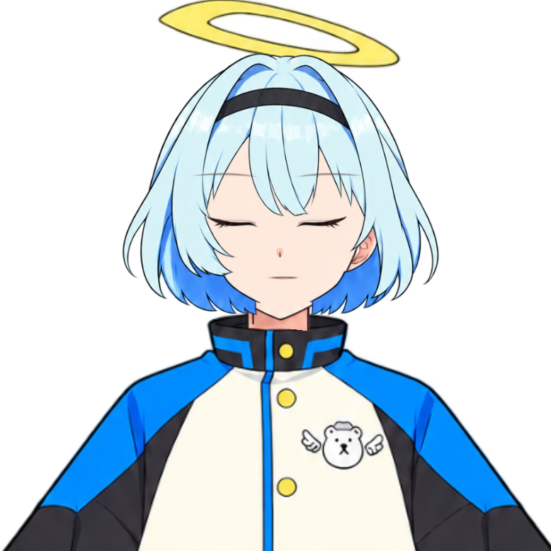
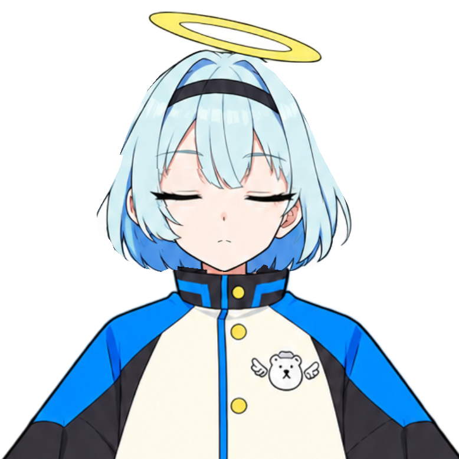

# 原画に合わせた顔・髪・首の修正比較

同じカメラ、同じ大きさ、停止した姿勢で、ESI-02が使うネイティブ描画から保存した画像です。比較画像を描き直したり合成したりしていません。

| 前回のモデル | 今回のモデル |
| --- | --- |
|  |  |
|  |  |

再開眼: 

今回、通常の目・特徴的なまつげ・眉・口・髪・輪は [原画](../../../src/esi/resources/rion-el.png) の画素を使いました。目を拡大したり左右を反転して描き直したりする方式をやめ、原画の自然な左右差を残しています。独立眉を髪より前へ置き、後ろ髪は顔の後ろへ置きます。首を顔と襟の後ろへ置き、通常時は原画の口を表示します。

閉眼は原画を参照した別の作画です。実際に見えるまつげの幅は今回の同じ比較画像で開眼が左92px・右90px、閉眼が左85px・右84pxです。画像差分内の暗い連結領域の幅であり、眼球の寸法ではありません。開眼→閉眼→再開眼で最初と最後の画素が一致し、まばたきで全部品の頂点が動かないことを確認しました。途中は開閉2枚を切り替える方式です。

テクスチャを詰めたときに未使用の絵が顔へ混ざる問題も修正し、顔への輪の混入と頭頂部の欠けを検査に追加しました。結果は [comparison.json](comparison.json)。

確認コマンド（描画可能な環境で実行）:

```sh
python scripts/validate-rinne-face.py --output /tmp/esi02-face-check
python scripts/validate-rinne-model.py --output /tmp/esi02-pose-check
```

PNGを変更せずにPSDへ格納できていることは独立したPSD読取り器でも確認しました。編集元と実行用モデルはリポジトリに保持しています。Windowsでの最終的な表示は更新後に確認してください。

保存したCMO3を開き直し、MOC3・model3・physics3・cdi3・テクスチャの5ファイルがすべてバイト単位で再生成できることを確認しました。
