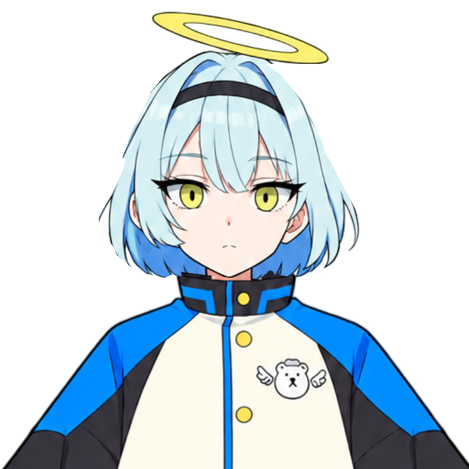
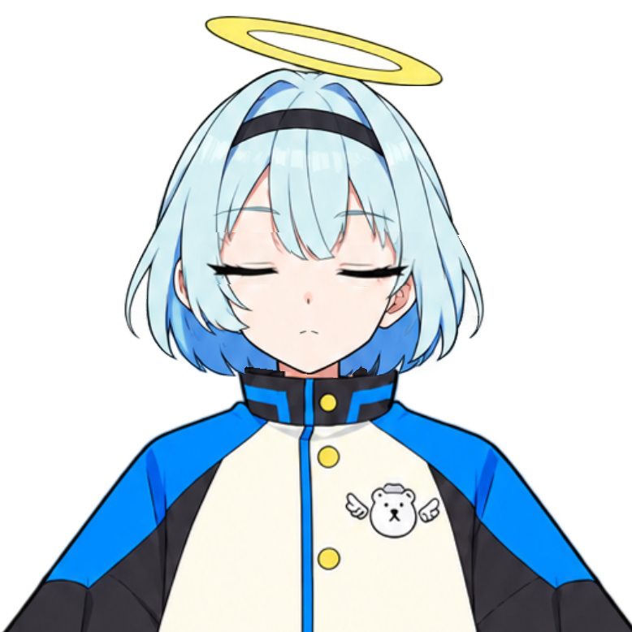
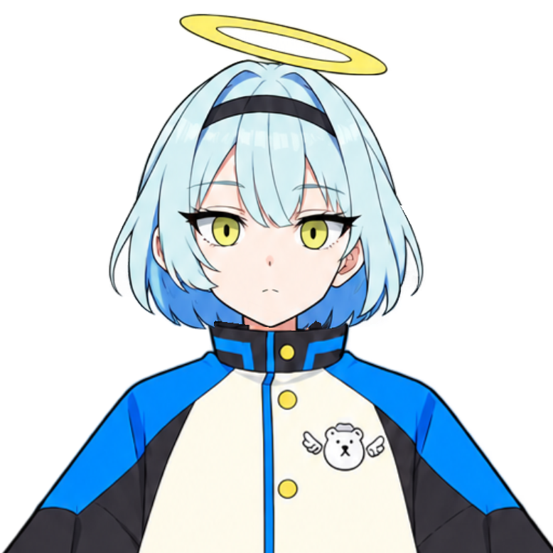

# ESI-03 髪とまばたきの確認

原画の線がメッシュの外へ切り落とされていた部分を修正し、外周を細かくしました。頭頂部の境界は11頂点から40頂点へ変更。原画・テクスチャの画素、顔の形、目・眉・口の作画を保っています。

同じネイティブ描画・カメラ・固定姿勢で比較しています。透過PNGの背景は閲覧環境によって変わります。

| 修正前 | ESI-03 |
| --- | --- |
|  |  |

| 開眼 | 閉眼 | 再開眼 |
| --- | --- | --- |
|  |  |  |

- 原画の輪郭線に沿う18地点で、暗い線の画素が実際に描画されることを検査。旧モデルでは左上の線が欠けて検査に失敗し、修正後はすべて通過。
- 開眼と再開眼は画素単位で一致。まばたき中は全メッシュの頂点が動かない。
- 閉眼のまつげ幅は左85・右84ピクセル。開眼の幅を超えず、左右の差は1ピクセル。
- 顔に輪の色が混入せず、頭頂部に透過の穴がない。
- 26部品、15種類の姿勢で、口・まばたき・髪・輪・頭・身体・呼吸の対象が正しく変化する。
- 保存したCMO3を開き直し、実行用5ファイルを同じ内容で再出力できる。

[顔・輪郭の結果](comparison.json)、[変形の結果](geometry.json)、[再出力の照合](source-export.json)。物理マイク・スピーカー・Windows上の表示の確認とは区別しています。
