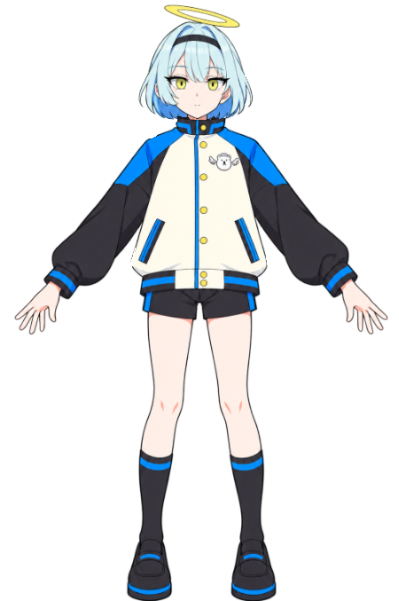
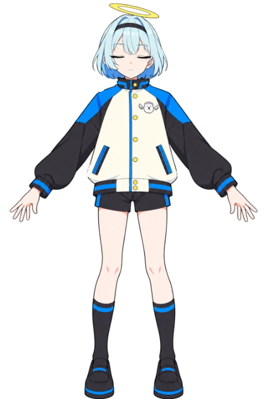
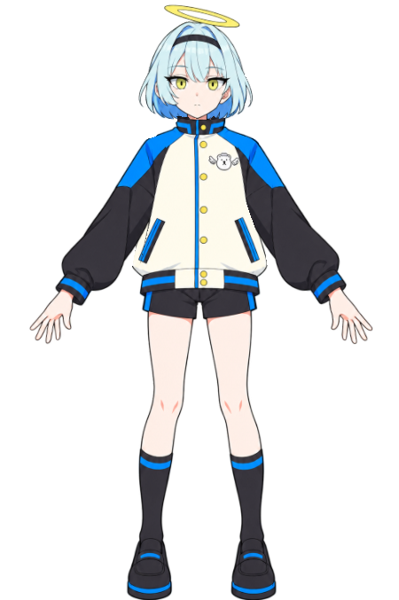
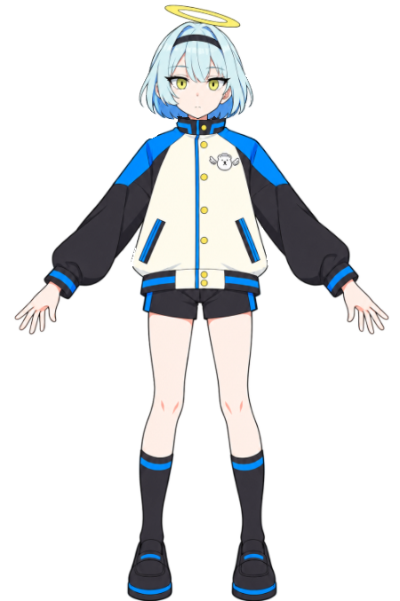

# ESI-04の実描画と再出力

Cubism Editor 5.3.04 FREEで保存した編集元から出力し、アプリと同じlive2d-pyのネイティブ描画で検査した画像です。通常時のテクスチャはESI-03と同じものを使っています。

| 通常 | 閉眼 | 開眼へ復帰 |
| --- | --- | --- |
|  |  |  |

通常と開眼復帰は画素単位で一致します。中間のまばたきも両方の目の絵を混ぜず、メッシュの位置や幅を変えません。

0.4.1では口を開く側の描画順も803にそろえました。0.4.0はメッシュが変形しても、開いた口が顔を補う絵の裏に隠れる不具合がありました。検査は見える口の画素まで確認するように修正しています。

| 無音・閉口 | 音量に応じた開口 | 無音へ復帰 |
| --- | --- | --- |
|  |  |  |

上の3枚は実アプリの描画から顔を切り出したものです。音量メーターの入力、口の見える変化、閉口への画素単位の復帰を確認しています。物理音声出力の実測ではありません。

| 腕の簡易ポーズ | 口の表情 |
| --- | --- |
|  |  |

両腕は左右別、眉は上下と傾き、閉じた口は表情の変形を持ちます。腕の内側・外側の端点を含む[22通りの検査結果](geometry.json)と、保存した編集元を閉じて再び開いた後の[5ファイルの再出力照合](reexport.json)を記録しています。

画像はクラウド上のX11/OpenGLで実際に描画したものです。WindowsのGPU・物理音声出力を確認したという記録ではありません。
