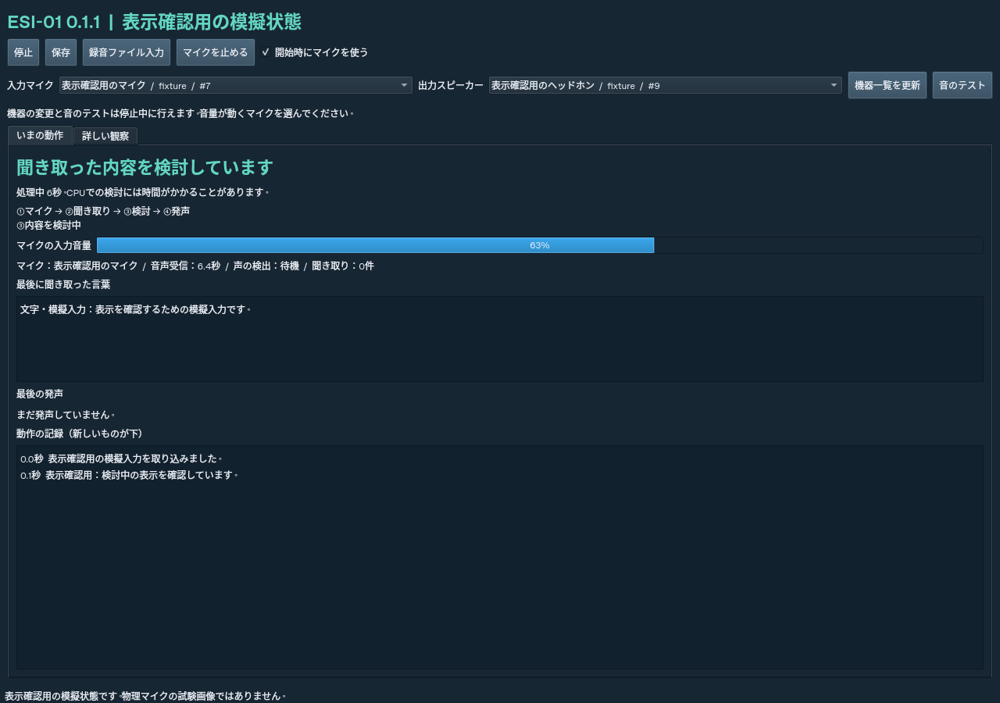

# いまの動作と音声機器を確認する

ESI-01 0.1.1 では、最初に「いまの動作」を表示します。研究用のグラフや数値は「詳しい観察」にあります。



## 話しかける前に

1. ESI が停止している状態で、「入力マイク」から使いたいマイクを選びます。
2. 「出力スピーカー」からヘッドホンやスピーカーを選びます。
3. 「音のテスト」を押します。短い音が聞こえるか確認してください。
4. 「開始時にマイクを使う」にチェックを入れ、「開始」を押します。
5. 短く話しかけて、「マイクの入力音量」が動くか見ます。話し終わってから少し間を空けてください。

同じ名前の機器が複数ある場合は、まず `WASAPI` と書かれたものを試してください。これは Windows の音声接続方式の名前です。

選んだ機器は開始時に保存します。再起動後、同じ機器を名前と接続方式で探します。見つからない場合は「選び直してください」と表示し、別の機器に無断で切り替えません。「Windows / OS の既定の機器」を選んだ場合は、Windows で設定した既定の機器を使います。

機器を変えるときは「停止」を押し、選び直してから開始します。接続した機器が一覧にない場合は「機器一覧を更新」を押してください。

## 表示の意味

| 表示 | 何が起きているか / 次に確認すること |
| --- | --- |
| 停止中 | 本体を開始する前です。機器を選んで「開始」を押します。 |
| マイクはOFFです | 本体は動いていますが、マイクを使っていません。「マイクを使う」で開始できます。 |
| 音声データを待っています | マイクからデータがまだ届いていません。続く場合は機器の選択と Windows のマイク設定を確認します。 |
| ほぼ無音です | データは届いていますが、音がほとんどありません。ミュート・録音音量・マイクの選択を確認します。 |
| 声らしい音を検出しています | 音声区間の検出が働いています。話し終わると聞き取りに進みます。 |
| 音声を言葉に変換しています | 聞き取りの処理中です。初回は音声認識モデルを読み込みます。経過秒数も表示します。 |
| 聞き取った内容を検討しています | 言語モデルが内容を処理しています。CPU では時間がかかることがあります。 |
| 前の入力の処理が終わるのを待っています | 最新の入力は記録済みで、前の推論が終わるのを待っています。 |
| 今回は「待つ」などを選びました | 入力に対して候補を比較した結果です。必ず発声する設計ではありません。 |
| 凛音エルの声を作っています | 発声する文章ができ、音声合成中です。 |
| 音声を再生しています | 選んだ出力機器への再生中です。 |
| 問題が起きています / 時間切れ | 処理が成功していません。下の記録と「詳しい観察」の技術状態に理由を表示します。 |

「最後に聞き取った言葉」が表示されれば、文字の認識まで進んでいます。「最後の発声」の「スピーカーで再生済み」は再生処理が完了したという記録です。ご本人に聞こえたかは、機器と音量でも確認してください。

「動作の記録」には、入力・検討・選択・声の作成・再生・問題など、実際に進んだ処理を順に表示します。聞き取り前でも入力音量と音声受信秒数を表示し、1秒ごとの入力状態をデータベースに記録します。

## 音量が動かないとき

Windows の「設定」→「システム」→「サウンド」→「入力」で、使いたいマイクを選びます。録音音量とミュートを確認し、Windows のテストでも音を拾うか調べてください。

「設定」→「プライバシーとセキュリティ」→「マイク」で、マイクへのアクセスと「デスクトップ アプリにマイクへのアクセスを許可する」が有効か確認します。

ESI の一覧で別のマイクを選び直す方法もあります。音量が動くのに聞き取れない場合は、表示された「声の検出」と「聞き取り」の状態を送ってください。

## 以前の ESI から更新する

1. ESI の画面で「停止」を押して閉じます。
2. [最新版の ZIP](https://github.com/TSUNAMI-SMP/Experiential-Synthetic-Intelligence-ESI-Project/archive/refs/heads/main.zip)をダウンロードし、別の場所に展開します。
3. 新しいフォルダーから **`src`、`tests`、`pyproject.toml`、`requirements.lock`** の4つを、今使っている `ESI-01` フォルダーへコピーし、同名のファイルを置き換えます。
4. 今使っている `ESI-01` フォルダーで PowerShell を開き、次を実行します。

```powershell
powershell -NoProfile -ExecutionPolicy Bypass -File .\scripts\install-windows.ps1
```

更新前に `data` を別の場所へコピーしておけば、経験の記録を手元にも残せます。更新のコピー先は今までのフォルダーです。`data`、`models`、`llama`、`.venv` はそのフォルダーに残します。音声機器の選択は `data/audio-devices.json` に保存し、実験の状態・学習・乱数設定とは別に扱います。

導入完了後は、いつものコマンドで画面を開きます。

```powershell
& .\.venv\Scripts\esi.exe --config config\windows.toml gui
```

## 仮アバターについて（今回は未実装）

Live2D などと連携できます。音声の大きさから口の開閉を作り、待機・聞き取り・検討・発声といった実際の処理状態に合わせて表示を動かせます。

簡単な仮アバターは、画像の差し替えや上下の動きから始められます。Live2D で滑らかに動かす場合は、目・口・体などを分けた絵と、動きを設定したモデルを用意します。今回は表示の連携機能を実装していません。
